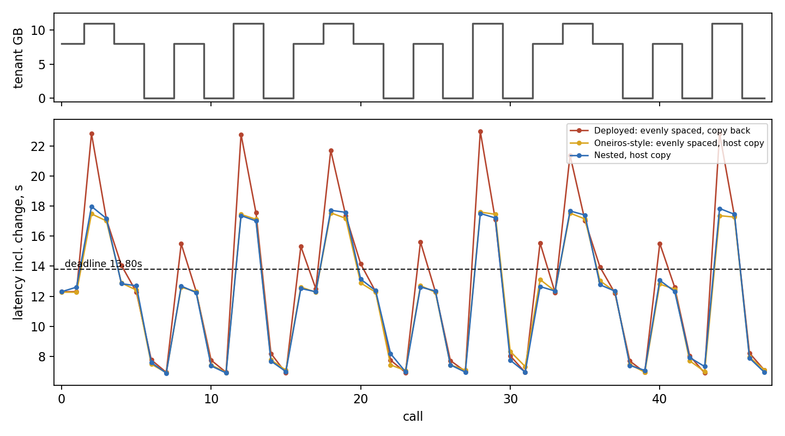
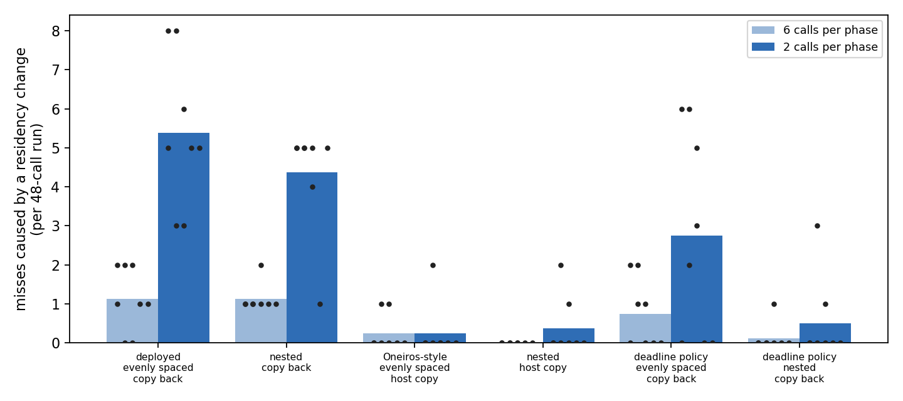
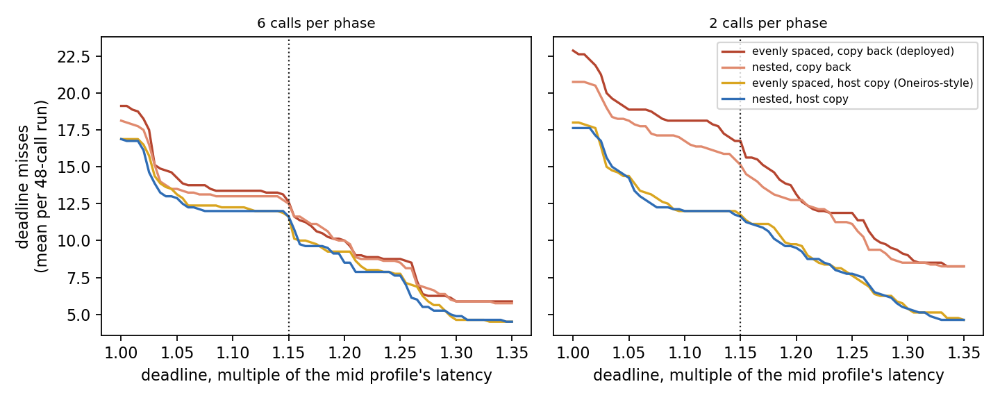

# Residency Scheduling for Oversized Vision-Language-Action Models

**Course:** CMPE 249, Intelligent Autonomous Systems, Fall 2026, Prof. Kaikai Liu
**Team:** Uday Arora
**Track:** Deployment Track

## Abstract

Vision-Language-Action (VLA) models for autonomous driving, such as NVIDIA's open 10-billion-parameter Alpamayo, are too large to fit in the memory of commodity and automotive-grade GPUs. A peer-reviewed system, `oom-free-alpamayo` (IEEE RTCSA 2026), fixes the fit problem by streaming model layers between CPU and GPU on demand, but the specific set of layers it keeps GPU-resident is decided once, offline, by capacity arithmetic on an idle GPU, and never revisited. This project treats that residency count as a characterized runtime knob rather than a fixed offline choice: it measures what the knob costs in latency and buys in memory footprint, evaluates selecting among pre-profiled residency configurations against the fixed static choice under a controlled competing workload, and measures the overhead of changing residency itself.

That overhead turned out to be the project's principal result, and it has two parts, both avoidable in the deployed design. The upstream placement rule spaces resident layers evenly, as Oneiros and Select-N also do, and is not nested across residency levels, so a change moves layers that did not need to move: up to 33 moves for a change of one. Any nested order meets the minimum of the change in count, which is the inclusion property of stack algorithms applied to resident layers; measured, it is up to 21.84x faster per transition with bit-identical outputs. And demoting a layer copies it back to host memory and pins it, where keeping a pinned host copy, standard in other offloading systems, makes demotion 9 to 14 times cheaper, again with identical outputs. Under a co-located workload whose memory demand changes, they do: in the deployed design, the cost of switching makes one call in nine miss at the faster churn rate. Keeping the host copy removes those misses; nested placement shortens every change but does not change the deadline outcome. Full numbers and sources: `proposal.md` and `literature-survey.md`.

## Deliverables

- `literature-survey.md`: SOTA survey (Deliverable B)
- `proposal.md`: problem formulation, technical approach, device and maintainer (Deliverable C)
- `novelty-feasibility-audit.md`: AI novelty and feasibility audit (Deliverable D)

## Repository Layout

```
scheduler/                  importable library, shared by every experiment
  paths.py                  resolves the repo, the upstream clone, and the results directory
  placement.py              nested residency placement via recursive bisection
  profiles.py               pre-profiled residency configurations and the switching rule
  policy.py                 continuous-K residency policy, evaluated under contention
  contention.py             competing GPU workload generator
  inputs.py                 driving-clip input preparation
  memory.py                 VRAM accounting and a competing allocator
  residency.py              changing the resident set, with copy or clean demotion
  trace.py                  a co-located tenant's changing demand, and the policies
  provenance.py             hardware and invocation recorded into every result

experiments/
  characterize/             latency and footprint per residency level
  placement/                move-optimality, transition cost, output equivalence
  switching/                static residency against profile switching
  dynamic/                  whether upgrading residency repays its own cost
  contention/               compute-contention boundary and interaction
  trace/                    static against switching under a changing tenant demand
  colocation/               two tenants sharing one GPU
  probes/                   bounded investigations that settled a design question

data/                       measured results, one JSON per run, suffixed by GPU
figures/                    the trace experiment's figures and an animation of one run
setup/setup_instance.sh     one-command GPU instance setup
```

## Results

**Static residency against profile switching, under a changing tenant.** The
primary experiment. A second process holds GPU memory following a pattern of
8, 11, 8, 0, 8, 0, 11 and 0 GB over 48 calls, each phase lasting 6 or 2
calls; the driving model must yield memory for the tenant to be admitted.
Three profiles, fast (K=33), mid (K=24) and compact (K=16); the deadline is
the mid profile's latency times 1.15, 13.80s. 120 runs on an RTX 3090: eight
repetitions over six clips, arm order shuffled, paired Wilcoxon signed-rank
(`data/trace_results_3090.json`).

| policy | miss rate | tenant refused | both served | mean latency |
|---|---|---|---|---|
| static fast (the upstream choice) | 0.000 | 0.625 | 0.375 | 6.72s |
| startup (reads free memory once) | 0.000 | 0.250 | 0.750 | 11.34s |
| static compact | 0.940 | 0.000 | 0.060 | 15.47s |
| switching, 2 calls per phase | 0.242 | 0.000 | 0.758 | 10.89s |

No static choice serves both. Switching admits the tenant on every call and
misses only in the 11GB phases, where the one profile that fits cannot meet
the deadline. Against startup the two measures trade one for one (calls with
both served 0.758 against 0.750, p=1.0) while mean latency is lower
(p=0.0078), because switching runs the fast profile while the tenant is idle.



**Does the cost of changing residency cause misses?** The two ways to make a
change cheaper, as a two-by-two, under the runtime policy. Each cell gives 6 / 2
calls per phase.

| placement, demotion | misses caused by a change | change seconds per run | tenant wait (median) |
|---|---|---|---|
| evenly spaced, copy back (deployed) | 1.12 / **5.38** | 19.7 / 62.2 | 5.6 / 3.9s |
| nested, copy back | 1.12 / 4.38 | 15.2 / 48.0 | 4.2 / 3.1s |
| evenly spaced, host copy (Oneiros-style) | 0.25 / 0.25 | 3.8 / 11.9 | 0.44 / 0.44s |
| nested, host copy | **0.00 / 0.38** | 3.3 / 10.6 | 0.40 / 0.36s |

In the deployed design it does, and demotion is why. Keeping a host copy
removes the misses (p=0.0078 at both churn rates) and shortens the tenant's
wait for memory roughly tenfold. Nested placement shortens every change, by
23 percent with copy demotion and 11 to 12 percent with a host copy
(p=0.0078 in all four), but changes no miss count detectably: with a host
copy, a promotion takes 0.3 to 0.7s against about 1.7s of slack. Scoring the
recorded calls against deadlines from 1.00 to 1.35 times the mid latency
gives the same picture at every deadline. Nesting costs nothing at steady
state (at most 0.13 percent). A policy that changes less often, preferring
the slowest profile that meets the deadline, also removes most change-caused
misses under copy demotion (0.50 against 4.38, p=0.0078), at 1.2s of mean
latency.





**Static residency against profile switching, under pressure held before
launch.** Eight repetitions per condition,
six clips cycled, paired Wilcoxon signed-rank. The deadline is the middle
profile's latency times 1.15, which is 14.16s. Memory pressure is an
independent process holding VRAM before the model process starts.

| pressure | static: completion / miss | switching: completion / miss | paired test |
|---|---|---|---|
| 0GB | 1.00 / 0.00 | 1.00 / 0.00 | arms identical, no test |
| 4GB | 1.00 / 0.00 | 1.00 / 0.00 | arms identical, no test |
| 7GB | **0.00** / 1.00 | **1.00** / **0.00** | W=0, p=0.0078, rank-biserial -1.000 |
| 10GB | **0.00** / 1.00 | **1.00** / 0.75 | p=0.50, not significant on miss rate |

At 7GB and 10GB the static configuration does not load at all, so it produces
no trajectory. Switching selects a smaller profile and completes every call.
Two qualifications belong with this result. At 10GB switching completes but
still misses three quarters of its deadlines, and the miss-rate difference
there is not significant, so the gain at that pressure is in completing at all
rather than in meeting deadlines. And p=0.0078 is the smallest value a
signed-rank test can return for eight pairs, so the 7GB result is a complete
separation whose precision is bounded by the sample size, not a marginal one.

Completion rate is reported beside miss rate because the two arms fail
differently: a run that never produces a trajectory misses every deadline, but
that is a different failure from producing trajectories too slowly.

**Does changing residency mid-run repay its own cost?** This is the feedback's
specific concern, that migration latency could make a better configuration
miss more deadlines. Memory is held so the process starts on the `compact`
profile, then released part way through the run, and the adaptive arm upgrades
while the fixed arm does not.

| clip | before upgrade | after upgrade | change |
|---|---|---|---|
| d497f01b | 16.95s | 6.99s | **-58.8%** |
| 441057af | 13.53s | 6.44s | -52.4% |
| 59aba96d | 16.25s | 6.88s | -57.7% |
| 8825b1fa | 14.34s | 6.60s | -54.0% |

The upgrade repays itself many times over: a gain above fifty percent against
a migration cost of a few seconds paid once. Both placement rules were run and
reach the same latency afterwards, 6.99s against 6.95s on the first clip,
which is the parity result again in a different setting. The qualification is
that this is a large profile change under a large change in available memory;
it does not establish that smaller or more frequent adjustments repay
themselves, and the rebuild cost described below is a reason to think frequent
ones may not.

**What the placement rule is worth end to end.** A workload alternating between
K=24 and K=16 over six changes with four inference calls between each, on an
RTX 4090, rebuilding the pipeline at every change as the upstream design
requires:

| placement | layers moved | transition | inference | total |
|---|---|---|---|---|
| nested | 72 | 15.44s | 185.86s | **201.30s** |
| upstream | 120 | 32.13s | 185.77s | **217.91s** |

Identical work, 7.7 percent less wall time, from moving 72 layers instead of
120 and spending 15.44 seconds on transitions instead of 32.13.

The end-to-end gain is far smaller than the 21.84x seen on a single transition,
and the reason is worth stating: inference dominates this workload at about
186 seconds against 15 to 32 seconds of transitions, so even halving the
transition cost moves the total by single digits. The benefit scales with how
often residency moves, and a policy that changes rarely gains little from any
improvement to the cost of changing.

**A cost of rebuilding the streaming pipeline, and how to remove it.** On the
RTX 3090, reconstructing the pipeline leaves inference about 13 percent slower
for as long as that pipeline lives, on roughly one reconstruction in four,
with residency unchanged and no layers moved. A residency change requires a
reconstruction, so an adaptive policy draws on this repeatedly where a static
one never does.

Eight causes were excluded, including clock ramp, allocator fragmentation and
staging buffer placement, the last because fast and slow rebuilds hold
identical buffer addresses. Carrying over one object at a time isolates the
cause: reusing only the prefetch stream gives a spread of 0.31 percent with no
slow rebuild in 14, while reusing only the CUDA events gives 12.06 percent
with four, which is the unfixed behaviour.

Recording which stream each reconstruction receives explains the rest. Sixteen
reconstructions drew eight distinct streams, each twice. Two ran at 18.83 to
18.89 seconds on both appearances, six at 16.72 to 16.76 on both, with no
stream in both groups. The streams come from a pool that is cycled and two of
its eight members are persistently slower, so a reconstruction is a draw.
Two in eight is 25 percent, against measured rates of 29, 20 and 29 percent.

Sharing a stream is not by itself the remedy. Eight trials that each kept the
stream they first drew came out 18.87, 16.63, 19.00, 16.66, 18.85, 16.66,
18.85 and 16.65 seconds, alternating because the pool is cycled in order.
Holding one stream keeps whichever was drawn, turning an intermittent penalty
on a quarter of reconstructions into a permanent one on a quarter of
processes. Avoiding the cost means identifying a fast member, which a few
calls suffice to do, rather than merely not redrawing.

This is a hazard some hardware exhibits rather than a property of the design.
The same measurement on an RTX 4090 spans 0.22 percent across 14
reconstructions, so the cost can be this large but is not always present. The
remedy costs nothing where the hazard is absent.

**Demoting a layer, and keeping a host copy.** Upstream makes a layer resident
by moving its only copy to the device, so demoting it copies it back to
pageable host memory and pins it. Inference never writes the weights, so a
pinned host copy kept from the start makes that transfer unnecessary.
Measured on an RTX 3090 over four cycles after a discarded one, in both orders:

| change | copy back (upstream) | host copy kept | |
|---|---|---|---|
| demote 8 layers | 2.42s | 0.28s | 8.8x |
| demote 9 layers | 2.71s | 0.28s | 9.7x |
| demote 17 layers | 4.97s | 0.36s | 13.9x |
| promote 17 layers | 0.74s | 0.72s | |

What remains is returning memory to the driver, which a co-located process
needs; the pipeline rebuild itself takes 0.015s. Outputs are bit-identical
across mechanisms. The price is 12.94GB of extra pinned host memory. This is
standard practice in FlexGen, DeepSpeed, Accelerate, vLLM and Oneiros, so it
is a correction to the upstream system rather than a contribution. Copy
demotion cost 0.29s per layer on this host and 0.71s on an earlier one, so
how much it matters depends on the host.

**Compute contention, a negative result.** A duty-cycled saturating workload
sharing the GPU under CUDA MPS slows every residency level proportionally, by
0.988x, 1.005x and 1.031x at K=16, 24 and 33. Residency has no lever against
compute contention, which is why memory pressure is the primary scenario.

**Residency change overhead.** Changing residency costs 0.3 to 4.7 seconds
against 7 to 17 seconds of inference, and is asymmetric: shedding layers is
three to six times dearer than restoring them, because offloading pins host
memory while restoring is a plain device copy. The nested placement rule
reduces this, by up to 21.84x at the single-level adjustments a switching
policy makes.

## Reproducing

Every experiment is a standalone script run from the repository root. Paths are
resolved from each file's own location, so the checkout can live anywhere.

**Without a GPU.** The placement results are combinatorial and the statistics run
against the measurements committed in `data/`, so both reproduce on any machine:

```
pip install -r requirements.txt
python scheduler/placement.py              # nesting, spread and move counts
python experiments/placement/theory.py     # move-optimality and the ablation
python experiments/switching/analyze.py    # static against profile switching
python experiments/contention/analyze.py   # the compute-contention boundary
python scheduler/trace.py                  # the trace and policies discriminate
python experiments/trace/simulate.py       # design check from committed costs
python experiments/trace/analyze.py        # the trace experiment
python experiments/trace/plot.py           # its figures, and --animate out.mp4
```

The upstream placement rule is reproduced in `scheduler/placement.py`, so
comparisons against it need neither the upstream package nor a GPU; its
self-check confirms the reproduction matches the original at every residency
level whenever the original is installed.

**With a GPU.** Taking the measurements needs a CUDA GPU with at least 12GB of
VRAM, the upstream Alpamayo packages, and access to a gated dataset:

```
bash setup/setup_instance.sh     # clones upstream, installs, fetches weights, profiles
python experiments/characterize/calibrate.py     # latency per residency level
python experiments/characterize/vram_per_k.py    # footprint per residency level
python experiments/characterize/build_profiles.py
VLA_PROFILES=data/profiles.json \
  python experiments/switching/run.py            # the primary experiment
python experiments/placement/benchmark.py        # transition cost and latency parity
python experiments/placement/eviction.py --demotion copy    # demotion cost, upstream
python experiments/placement/eviction.py --demotion clean   # demotion cost, host copy kept
VLA_PROFILES=data/profiles.json \
  python experiments/trace/run.py                # static against switching, changing tenant
```

The trace experiment needs a 24GB card and checks before starting that its
demand pattern separates the policies with the profiles in use. Keeping a
host copy of every layer pins the whole model in host memory, so allow at
least 64GB of RAM.

The profiles committed in `scheduler/profiles.py` were measured on an RTX 3090
and the deadline is derived from them, so they describe that card and not the
one running. `build_profiles.py` turns the two characterization runs into a
profile file for the machine in use, and refuses to emit one whose deadline
fails to separate the profiles, since a comparison against static residency
would then carry no information.

`nvidia/PhysicalAI-Autonomous-Vehicles` is gated and needs a Hugging Face token
whose "read public gated repos" permission is explicitly enabled, which is not
granted by default. Place it where `huggingface_hub` stores tokens, or export
`HF_TOKEN`. Setup honours `WORKDIR` for where the upstream clones live and
`VENV` for a virtualenv to activate; experiments honour `ALPAMAYO_HOME` for a
clone that is not a sibling of this repository and `VLA_RESULTS` for an output
directory other than `data/`.

Results are written with the GPU, driver, PCIe link and invocation that produced
them, so any number in `data/` can be traced to its hardware.

## Foundation

This project extends `aveeslab/oom-free-alpamayo`, the open-source release accompanying its IEEE RTCSA 2026 paper, which itself depends on NVIDIA's open Alpamayo model and inference source. Full citations and links are in `literature-survey.md`.
