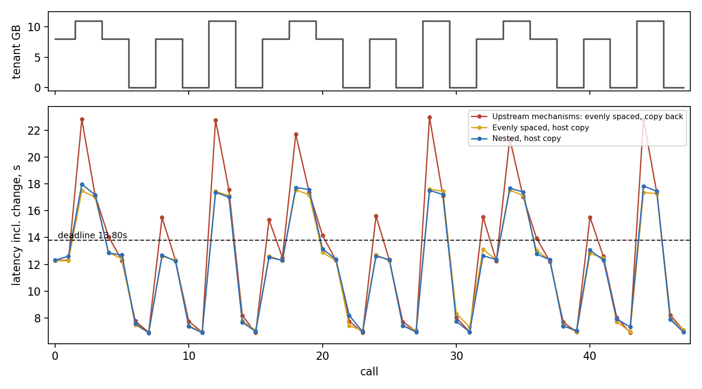
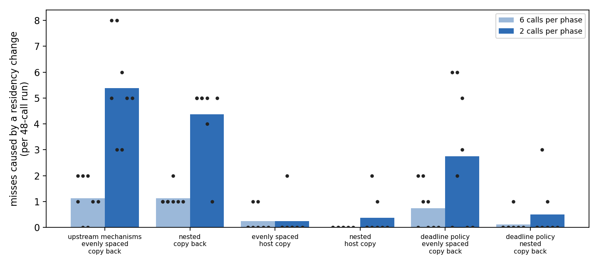
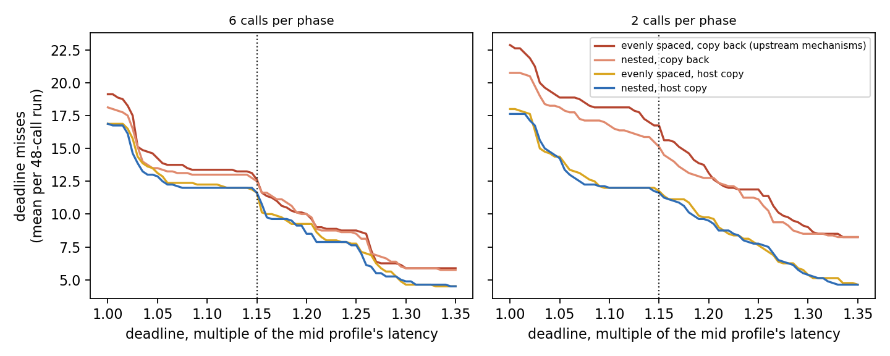

# Residency Scheduling for Oversized Vision-Language-Action Models

**Course:** CMPE 249, Intelligent Autonomous Systems, Fall 2026, Prof. Kaikai Liu
**Team:** Uday Arora
**Track:** Deployment Track

## In brief

- **Problem.** NVIDIA's Alpamayo-R1-10B driving model, 22GB of weights, does not fit in the 12 to 16GB of widely available consumer GPUs, so `oom-free-alpamayo`, the published system this project builds on (called upstream below), keeps some of its 36 language-model layers on the GPU and streams the rest from host memory on every call. How many layers stay on the GPU, the residency level K, is fixed once, offline. When a second process on the same GPU (a tenant) needs memory, a fixed K either refuses the tenant or, if chosen small enough for it, runs slowly all the time.
- **Question.** Can the model share a GPU with a tenant whose memory demand changes by switching among pre-measured residency levels, and does the cost of changing residency cause deadline misses that a fixed choice avoids?
- **Main result.** On an RTX 3090, over 48-call runs (8 paired repetitions per policy), a policy told the tenant's demand before each call switches among three pre-measured residency levels (profiles). With nested placement and a host copy (terms below), it never refuses the tenant and serves both the tenant and the 13.80s deadline (1.15 times the mid profile's latency) on 0.758 of calls. Startup selection serves both on 0.750 (p=1.0): it refuses the tenant on 0.250 of calls where switching misses 0.242, and its mean latency is higher (p=0.0078). With the upstream mechanisms (evenly spaced placement, copy back; terms below), switching serves both on only 0.651 at the faster churn rate, below startup selection (p=0.0156). At deadlines of 1.00 to 1.30 times the mid profile's latency the two do not differ detectably; from 1.40 times switching serves both on more (p=0.031).
- **Cost of changing residency.** Under the upstream mechanisms, yes: at 2 calls per phase residency changes cause 5.38 misses per 48-call run (about one call in nine), which a fixed choice never incurs; keeping a host copy cuts that to 0.25 per run (p=0.0078).
- **Reproduce without a GPU.** `pip install -r requirements.txt`, then `python experiments/trace/analyze.py` recomputes the primary experiment's tables and tests from the measurements committed in `data/`. The other analysis scripts are listed under [Reproducing](#reproducing).



Startup selection, not shown, holds the mid profile (K=24) throughout and refuses the tenant in the 11GB phases.

Terms used below:

- **Residency level K**: the number of the 36 language-model layers kept on the GPU; the rest are copied in from host memory during each call.
- **Profile**: a residency level whose latency and GPU memory footprint were measured in advance. Three are used: fast (K=33), mid (K=24) and compact (K=16).
- **Promotion / demotion**: making a layer resident on the GPU / removing it from the GPU.
- **Pinned memory**: page-locked host memory, which the GPU can copy from directly and which the operating system cannot page out.
- **Host copy**: a pinned copy of all 36 language-model layers, resident ones included, kept in host memory, so that demotion only frees GPU memory instead of copying the layer back.
- **Nested placement**: an order of layers in which the layers resident at a level K are always a subset of those resident at K+1, so a change of level moves only as many layers as the level changes by. Upstream instead spaces resident layers evenly.
- **Copy back**: demotion through the upstream streaming path, which copies the layer from the GPU to host memory and pins it there.
- **The upstream mechanisms**: a residency change built from the upstream system's own mechanisms, evenly spaced placement and copy back. Upstream itself fixes residency at startup and never changes it.
- **Pipeline**: upstream's double-buffered prefetch, which copies each streamed layer into one of two GPU buffers on a separate CUDA stream (the prefetch stream) while the previous layer computes; it is rebuilt at every residency change.
- **Churn rate**: how often the tenant's demand changes, given as calls per phase (2 or 6) of its demand pattern.
- **Startup selection**: choosing the fastest profile that fits once, at launch, and keeping it for the whole run; in the trace experiment it chooses from the memory the tenant leaves at the first call.
- **Spread**: the longest run of consecutive non-resident layers at a residency level.

## Abstract

Vision-Language-Action (VLA) models for autonomous driving, such as NVIDIA's open Alpamayo-R1-10B (about 11 billion parameters, 22GB of weights), are too large to fit in the 12 to 16GB of memory of widely available consumer GPUs. A peer-reviewed system, `oom-free-alpamayo` (IEEE RTCSA 2026), fixes the fit problem by streaming model layers between CPU and GPU on demand, but the specific set of layers it keeps GPU-resident is decided once, offline, by capacity arithmetic on an idle GPU, and never revisited. This project treats that residency count as a characterized runtime knob rather than a fixed offline choice: it measures what the knob costs in latency and buys in memory footprint, evaluates selecting among pre-profiled residency configurations against the fixed static choice under a controlled competing workload, and measures the overhead of changing residency itself.

In the primary experiment an RTX 3090 is shared with a tenant whose memory demand changes. Switching among three pre-measured residency configurations, with nested placement and a host copy, admits the tenant on every call and serves both the tenant and the deadline on 0.758 of calls; startup selection serves both on 0.750 (p=1.0), refusing the tenant on a quarter of calls where switching misses deadlines instead. With a residency change built from the upstream system's own mechanisms (evenly spaced placement, copy back), switching serves both on only 0.651 of calls at the faster churn rate, fewer than startup selection (p=0.0156), so the cost of changing residency decides whether switching is competitive. That overhead includes two avoidable costs under the upstream mechanisms. The upstream placement rule spaces resident layers evenly, much as the LLM inference systems Oneiros and Select-N space the layers they stream, and is not nested across residency levels, so a change moves layers that did not need to move: up to 33 moves for a change of one. Any nested order meets the minimum of the change in count, which is the inclusion property of stack algorithms applied to resident layers; measured on the benchmark's matched transition paths, a single-level change is about 22 times faster on an RTX 4090 (21.84x and 22.82x in the two measurement orders) and 11.80 to 15.81 times faster on an RTX 3090 and an RTX 5070 Ti, and nested and evenly spaced placement give bit-identical outputs (RTX 3090). And demoting a layer copies it back to host memory and pins it, where keeping a pinned host copy of every layer, as Oneiros does, makes demotion 8.9 to 13.9 times cheaper on an RTX 3090, again with identical outputs. Under the upstream mechanisms, residency changes make about one call in nine miss at the faster churn rate (5.38 misses per 48-call run). Keeping the host copy removes nearly all of those misses (5.38 to 0.25 per run). Nested placement shortens every kind of change but does not detectably change how many misses a change causes, although under copy demotion at 2 calls per phase it lowers total misses from 16.75 to 15.12 per run (p=0.031, uncorrected). Full numbers are in the Results below and in `data/`; sources are in `literature-survey.md`.

## Planning documents

- `literature-survey.md`: survey of related systems
- `proposal.md`: problem formulation, technical approach, device and maintainer
- `novelty-feasibility-audit.md`: novelty and feasibility audit

These planning documents are not revised to match the results; where their numbers or conclusions differ from the results here, the results and `data/` are authoritative.

## Repository Layout

```
scheduler/                  importable library, shared by every experiment
  paths.py                  resolves the repo, the upstream clone, and the results directory
  placement.py              nested residency placement via recursive bisection
  profiles.py               pre-profiled residency configurations and the switching rule
  policy.py                 continuous-K controller driven by latency drift (contention/run.py)
  contention.py             competing GPU workload generator
  inputs.py                 driving-clip input preparation
  memory.py                 VRAM accounting and a competing allocator
  residency.py              changing the resident set, with copy or clean demotion
  trace.py                  a co-located tenant's changing demand, and the policies
  provenance.py             hardware and invocation, recorded into the meta of results produced with it

experiments/
  characterize/             latency and footprint per residency level
  placement/                move-optimality, transition and demotion cost, output equivalence, post-change slowdown
  switching/                static residency against profile switching
  dynamic/                  whether upgrading residency repays its own cost
  contention/               compute-contention boundary and interaction
  trace/                    static against switching under a changing tenant demand
  colocation/               two tenants sharing one GPU
  probes/                   bounded investigations that settled a design question

data/                       measured results, one JSON per run, named with the GPU it ran on, and profiles_3090.json built from two of them
figures/                    the trace experiment's figures, and trace_demo_L2.mp4, an animation of one repetition (plot.py --animate)
setup/setup_instance.sh     one-command GPU instance setup, upstream checked out at a fixed commit
setup/reproduce.sh          re-runs the primary measurements behind data/, resumable
```

## Results

**The residency tradeoff.** Latency per call (mean of 5) and GPU memory used
by the model process, by residency level, on the primary RTX 3090
(`calibration_3090.json`, `vram_per_k_3090.json`). With every layer streamed
(K=0) a call takes 26.58s.

| K | 8 | 12 | 16 | 20 | 24 | 28 | 33 |
|---|---|---|---|---|---|---|---|
| latency | 21.61s | 19.13s | 16.72s | 14.35s | 12.00s | 9.64s | 6.73s |
| GPU memory | 7.80GB | 9.34GB | 10.78GB | 12.17GB | 13.60GB | 14.99GB | 16.68GB |

K=33 is what the upstream rule picks on a 24GB card. The three profiles are
K=33, 24 and 16.

**Static residency against profile switching, under a changing tenant.** The
primary experiment. A second process holds GPU memory following a pattern of
8, 11, 8, 0, 8, 0, 11 and 0 GB over 48 calls, each phase lasting 6 calls (one
pass of the pattern) or 2 calls (three passes); the driving model must yield
memory for the tenant to be admitted. Three profiles, fast (K=33), mid (K=24)
and compact (K=16), were measured on one clip (d497f01b). The deadline is the
mid profile's calibrated latency (12.00s) times 1.15, 13.80s, 1.8s above it.
In the trace the median steady K=24 inference time per clip (calls that
changed residency excluded) ranged from 10.33 to 12.33s, the calibration clip
being the slowest, so the deadline sat 1.46 to 3.47s above it by clip. Before each call the runtime switching policy is
given the memory the tenant leaves it (total memory minus the tenant's demand
minus a 1GB margin) and takes the fastest profile that fits. 120 runs on an
RTX 3090: eight repetitions over six clips, arm order shuffled, paired by
repetition, two-sided Wilcoxon signed-rank test, exact (scipy 1.15 or later; with ties
or zero differences it enumerates all sign assignments;
`data/trace_results_3090.json`). The six clips are fixed in
`experiments/trace/run.py` (the same list in `experiments/switching/run.py`,
whose first four `experiments/dynamic/run.py` uses); upstream's default
example clip (030c760c) is not among them, and no selection rule beyond that
list is recorded. The static and startup selection arms ran at 6 calls
per phase and serve as the comparison at both churn rates. They never change
residency, so the churn rate cannot affect them: each call's outcome depends
on its demand and on the clip, and both churn rates give each demand the same
share of calls.

| policy | miss rate | tenant refused | both served | mean latency |
|---|---|---|---|---|
| static fast (K=33, the upstream choice) | 0.000 | 0.625 | 0.375 | 6.72s |
| startup selection | 0.000 | 0.250 | 0.750 | 11.34s |
| static compact (sized for the largest demand) | 0.940 | 0.000 | 0.060 | 15.47s |
| switching, nested placement, host copy, 2 calls per phase | 0.242 | 0.000 | 0.758 | 10.89s |
| switching, nested placement, host copy, 6 calls per phase | 0.242 | 0.000 | 0.758 | 10.72s |
| switching, upstream mechanisms (evenly spaced, copy back), 2 calls per phase | 0.349 | 0.000 | 0.651 | 11.93s |
| switching, upstream mechanisms (evenly spaced, copy back), 6 calls per phase | 0.263 | 0.000 | 0.737 | 11.04s |
| deadline policy (nested placement, copy back), 2 calls per phase | 0.232 | 0.000 | 0.768 | 12.78s |
| deadline policy (nested placement, copy back), 6 calls per phase | 0.240 | 0.000 | 0.760 | 12.53s |

"Both served" is the share of calls on which the model met its deadline and
the tenant was admitted. Miss rate alone rewards refusing the tenant, so both
measures are reported. Neither static choice serves both reliably: static
fast refuses the tenant whenever it asks for memory, and static compact
misses almost every deadline. On miss rate alone static fast is better than
switching (0.000 against 0.242, p=0.0078); switching's gain is admitting the
tenant. Switching with nested placement and a host copy admits it on every
call and misses only in the 11GB phases, where the one profile that fits
rarely meets the deadline (93 of the 96 such calls missed at each churn
rate). Against startup selection the two trade refusals for misses almost
one for one (both served 0.758 against 0.750, p=1.0 at both churn rates),
while mean latency is lower (10.89 and 10.72s against 11.34s, p=0.0078 at
both), because switching runs the fast profile while the tenant is idle.
Because the trace opens at 8GB, startup selection holds the mid profile
throughout, which is the best of the three fixed profiles in hindsight (both
served 0.750 against 0.375 for fast and 0.060 for compact), so it is the
strongest fixed-profile baseline this trace admits (any level too large for
the 11GB phases is refused on at least a quarter of calls).

The host copy is what makes switching competitive with startup selection. With the
upstream mechanisms (evenly spaced placement, copy back), switching serves both on 0.651 of calls at 2 calls per phase, below startup
selection's 0.750 (p=0.0156), and on 0.737 at 6 calls per phase (p=0.28). The deadline
policy with nested placement, which takes the smallest profile that still
meets the deadline and so changes less often (below), serves both on 0.768
and 0.760 of calls even with copy back, the highest of any arm at this
deadline, though not detectably above startup selection (p=0.50 at both churn
rates); with evenly spaced placement it serves both on 0.729 and 0.755. It consults the deadline,
so it is left out of the rescoring that follows.

The comparison depends on the deadline. Rescoring the recorded calls at
deadlines from 1.00 to 1.50 times the mid latency
(`experiments/trace/analyze.py`, section "Deadline sensitivity, all arms,
fraction of calls with both served"), switching and startup selection do not
differ detectably on calls with both served for deadlines up to 1.30 times
the mid latency (p ≥ 0.0625 at both churn rates; identical at 1.10 times).
Switching serves both on more calls from 1.40 times (0.922 and 0.935 against
0.750, p=0.031; p=0.0078 at 1.50 times), where static compact also catches up
by 1.50 times (1.000, against 0.997 for switching). At the eight rescored
deadlines from 1.00 to 1.50 times, switching is never more than 0.037 below
the best rescored policy at that deadline, against up to 0.25 for startup
selection and 0.75 for static compact.

**Does the cost of changing residency cause misses?** The two ways to make a
change cheaper, as a two-by-two, under the runtime policy. Each cell gives 6 / 2
calls per phase.

| placement, demotion | misses caused by a change | change seconds per run | tenant wait (median) |
|---|---|---|---|
| evenly spaced, copy back (upstream mechanisms) | 1.12 / **5.38** | 19.7 / 62.2 | 5.6 / 3.9s |
| nested, copy back | 1.12 / 4.38 | 15.2 / 48.0 | 4.2 / 3.1s |
| evenly spaced, host copy | 0.25 / **0.25** | 3.8 / 11.9 | 0.44 / 0.44s |
| nested, host copy | **0.00** / 0.38 | 3.3 / 10.6 | 0.40 / 0.36s |

Under the upstream mechanisms it does, and demotion is why. Keeping a host copy
removes nearly all of those misses: with nested placement from 4.38 to 0.38
and from 1.12 to 0.00 (p=0.0078 at both churn rates), and with evenly spaced
placement from 5.38 to 0.25 (p=0.0078) and from 1.12 to 0.25 (p=0.125). It
also shortens the tenant's wait for memory roughly tenfold. Nested placement
shortens every kind of change, total change time by 23 percent with copy
demotion and 11 to 12 percent with a host copy (p=0.0078 in all four), but
does not detectably change the misses a change causes (4.38 against 5.38,
p=0.28; 1.12 against 1.12; 0.38 against 0.25; 0.00 against 0.25, p=0.5),
although under copy demotion at 2 calls per phase it lowers total misses
from 16.75 to 15.12 per run (p=0.031, uncorrected). With a host copy a change
takes 0.28 to 0.94s, and the few misses it causes all fall on compact-profile
calls whose inference alone came within 0.1s of the deadline. As an
exploratory check, scoring the recorded calls against deadlines from 1.00 to
1.35 times the mid latency (`figures/trace_deadline_sensitivity.png`;
`analyze.py` section "Deadline sensitivity, runtime arms" tabulates 1.05 to
1.30) keeps the ordering: with either placement, the host-copy arm never misses
more than the copy-back arm, and at 1.05 and 1.10 times the two placements
with a host copy do not differ detectably (p ≥ 0.5). In these runs nesting
costs nothing measurable at steady state (at most 0.13 percent at equal K,
none significant). The deadline policy, which changes less often, also
removes most change-caused misses under copy demotion with nested placement
(0.50 against 4.38 at 2 calls per phase, 0.12 against 1.12 at 6, p=0.0078
each); with evenly spaced placement it removes about half at 2 calls per
phase (2.75 against 5.38, p=0.039) and not detectably at 6 (0.75 against
1.12, p=0.53). With nested placement it costs 1.1s of mean latency at 2
calls per phase and 1.6s at 6 (p=0.0078 each).





**Static residency against startup selection, under pressure held before
launch.** Eight repetitions per condition, six clips cycled, paired Wilcoxon
signed-rank. The deadline is the mid profile's latency times 1.15, which
is 14.16s. Memory pressure is an independent process holding VRAM before the
model process starts. The startup selection arm reads free memory once, at
launch, and selects the fastest profile that fits;
`experiments/switching/analyze.py` labels it `switching`.

| pressure | static: completion / miss | startup selection: completion / miss | paired test |
|---|---|---|---|
| 0GB | 1.00 / 0.00 | 1.00 / 0.00 | arms identical, no test |
| 4GB | 1.00 / 0.00 | 1.00 / 0.00 | arms identical, no test |
| 7GB | **0.00** / 1.00 | **1.00** / **0.00** | W=0, p=0.0078, rank-biserial -1.000 (an effect size from -1 to 1; -1 means every pair favours startup selection) |
| 10GB | **0.00** / 1.00 | **1.00** / 0.75 | p=0.50, not significant on miss rate |

At 10GB the static configuration does not load at all, and at 7GB it loads
but runs out of memory before completing a call, so it produces no trajectory
at either. Startup selection picks a smaller profile and completes every
call. Two qualifications belong with this result. At 10GB it completes but
still misses three quarters of its deadlines, and the miss-rate difference
there is not significant, so the gain at that pressure is in completing at all
rather than in meeting deadlines. And p=0.0078 is the smallest value a
signed-rank test can return for eight pairs, so the 7GB result is a complete
separation whose precision is bounded by the sample size, not a marginal one.

Completion rate is reported beside miss rate because the two arms fail
differently: a run that never produces a trajectory misses every deadline, but
that is a different failure from producing trajectories too slowly.

**Does changing residency mid-run repay its own cost?** The concern is that
migration latency could make a better configuration miss more deadlines.
Memory is held so the process starts on the `compact` profile, then released
part way through the run, and the adaptive arm upgrades while the fixed arm
does not.

| clip | median before upgrade | median after upgrade | change |
|---|---|---|---|
| d497f01b | 16.95s | 6.99s | **-58.8%** |
| 441057af | 13.53s | 6.44s | -52.4% |
| 59aba96d | 16.25s | 6.88s | -57.7% |
| 8825b1fa | 14.34s | 6.60s | -54.0% |

Each cell is the median call time of the adaptive arm with nested placement.
After the upgrade calls are 52 to 59 percent faster, against a migration cost
of 0.59 to 1.04 seconds paid once. Both placement rules were run and reach
latencies within 2 percent of each other afterwards (6.99s against 6.95s on
the first clip; nested 0.66, 1.72 and 1.91 percent slower on three clips and
1.12 percent faster on one), differences larger than the steady-state parity
measured at equal K; each arm ran in its own process and always in the same
order, so process and order effects are not separated. This is one large
profile change under a large change in available memory; frequent smaller changes are what the trace experiment above
measures.

**What the placement rule is worth end to end.** A workload alternating between
K=24 and K=16 over six changes with four timed inference calls between each
(after one untimed settling call), on an
RTX 4090, rebuilding the pipeline at every change as the upstream design
requires:

| placement | layers moved | transition | inference | total |
|---|---|---|---|---|
| nested | 72 | 15.44s | 185.86s | **201.30s** |
| upstream | 120 | 32.13s | 185.77s | **217.91s** |

Identical work, 7.6 percent less wall time, from moving 72 layers instead of
120 and spending 15.44 seconds on transitions instead of 32.13, 2.08 times
less. Layers moved and transition time include the first load to K=24 (24
layers, 1.21s nested and 3.48s upstream); the six changes alone move 48
against 96 layers in 14.23 against 28.65 seconds, 2.01 times less.

The end-to-end gain is far smaller than the 22x seen on a single-level
transition of the matched paths. These are eight-level changes, where nesting saves fewer moves,
and inference dominates this workload at about 186 seconds against 15 to 32
seconds of transitions, so even halving the transition cost moves the total
by single digits. The benefit scales with how often residency moves, and a
policy that changes rarely gains little from any improvement to the cost of
changing.

**A cost of rebuilding the streaming pipeline, and how to remove it.** On one
RTX 3090 host (driver 580.178.04), reconstructing the pipeline leaves
inference 11 to 13 percent slower for as long as that pipeline lives, on
roughly one reconstruction in four, with residency unchanged and no layers
moved. A residency change requires a reconstruction, so an adaptive policy
draws on this repeatedly where a static one never does.

Other causes were excluded by direct measurement, among them clock ramp
(`clock_ramp_*_3090.json`), allocator fragmentation
(`transition_residue_3090.json`), the amount of newly pinned memory
(`pinning_scaling_3090.json`) and staging buffer placement
(`buffer_placement2_3090.json`), the last because fast and slow rebuilds hold
identical buffer addresses. Carrying over one object at a time isolates the
cause: reusing only the prefetch stream gives a latency range of 0.31 percent across rebuilds with no
slow rebuild in 14, while reusing only the CUDA events gives 12.06 percent
with four, which is the unfixed behaviour.

Recording which stream each reconstruction receives explains the rest. Sixteen
reconstructions drew eight distinct streams, each twice. Two ran at 18.83 to
18.89 seconds on both appearances, six at 16.72 to 16.76 on both, with no
stream in both groups. The streams come from PyTorch's stream pool, which hands them out in rotation;
this hook received eight of them in turn, two of which are persistently
slower, so a reconstruction is a draw.
Two in eight is 25 percent, against measured rates of 22 to 31 percent in
four runs (14 of 50 reconstructions, not counting each run's first build).

Sharing a stream is not by itself the remedy. Eight trials that each kept the
stream they first drew came out 18.87, 16.63, 19.00, 16.66, 18.85, 16.66,
18.85 and 16.65 seconds, alternating because the pool is cycled in order.
Holding one stream keeps whichever was drawn, turning an intermittent penalty
on a quarter of reconstructions into a permanent one for whatever drew a slow
stream: four of these eight trials, all in one process, did. In the same run
the eight trials that drew a new stream at every rebuild were all fast (16.65
to 16.78 seconds). Avoiding the
cost means identifying a fast member, which a few calls suffice to do, rather
than merely not redrawing.

This is a hazard some hardware exhibits rather than a property of the design.
The same measurement on an RTX 4090 spans 0.22 percent across 14
reconstructions, so the cost can be this large but is not always present. On
the trace host no stretch
between residency changes ran more than 9 percent above its clip-and-K median
(1336 stretches, `experiments/trace/analyze.py`), so the slow-stream hazard did
not shape the trace results.

**Demoting a layer, and keeping a host copy.** Upstream makes a layer resident
by moving its only copy to the device, so demoting it copies it back to
pageable host memory and pins it. Inference never writes the weights, so a
pinned host copy kept from the start makes that transfer unnecessary.
Measured on an RTX 3090 over four cycles after a discarded one, in both
orders; each cell is the median of each run, averaged over the two orders:

| change | copy back (upstream) | host copy kept | |
|---|---|---|---|
| demote 8 layers | 2.44s | 0.27s | 8.9x |
| demote 9 layers | 2.71s | 0.28s | 9.7x |
| demote 17 layers | 4.97s | 0.36s | 13.9x |
| promote 17 layers | 0.74s | 0.71s | |

What remains is returning memory to the driver, which a co-located process
needs; the pipeline rebuild itself takes about 0.014s. Outputs are
bit-identical across mechanisms. The price is a pinned host copy of all 36
language-model layers, 12.94GB; upstream already pins the streamed layers, so
the extra pinned memory is the resident layers' share. FlexGen, DeepSpeed
ZeRO-Inference, Accelerate and vLLM (`vllm/model_executor/offloader/uva.py`
at commit `b2a9480`) keep the authoritative copy of offloaded weights off the GPU, in host
memory or on disk, but the weights they place on the GPU are held only there, a
placement fixed at load time; Oneiros and PipeSwitch, which change what is
resident at runtime, keep a host copy of everything they may evict, Oneiros a
pinned copy of every layer. Keeping that copy is therefore a correction to
the upstream system rather than a contribution. Copy demotion cost about 0.30s
per layer on this host and 0.68 to 0.73s per layer on the second RTX 3090
host (`adaptive_cost_3090.json`, 5.41 to 5.81s per 8 layers); both figures
include the pipeline rebuild.

**Compute contention, a negative result.** A second process running a
saturating matrix-multiply (GEMM) kernel at a 70 percent duty cycle, sharing
the GPU through CUDA MPS (NVIDIA's Multi-Process Service, which lets kernels
from several processes run concurrently), adds a roughly constant time to
every residency level, 1.70, 2.23 and 2.12s at K=16, 24 and 33 (difference of
medians; 1.20 to 1.54 times the uncontended latency), over
8 repetitions in alternating order. The added time is not uniform: in every
repetition the first contended call slowed by 0.48 to 1.28s and the second by
2.43 to 3.79s, against the mean of that repetition's uncontended calls (`data/compute_interaction_3090.json`, on the third RTX 3090
host, PCIe 4.0). The fastest configuration stays fastest under contention,
6.04s at K=33 against 10.28s at K=16, and every contended K=33 call (4.41 to
7.71s) was faster than every contended K=16 call (9.23 to 11.51s), so lowering
residency did not help at this duty cycle. With the deadline set by the same
rule on that host (mid latency times 1.15, 7.31s), contention raises the miss
rate from 0 to 0.50 at K=33 and from 0 to 1.00 at K=24; K=16 misses with or
without it. In separate runs on an RTX 3090 whose host was not recorded, the
same 70 percent load raised mean K=33 latency from 7.01 to 9.16s on one clip
and from 6.49 to 8.59s on another (`compute_contention_3090.json`), and
contention barely changed free memory (22.77GB under contention in
`compute_boundary_results_3090.json` against 23.01GB without it in
`switch_results_3090.json`), so a policy reading free memory selects the same
profile. Residency has no lever against compute contention, which is why
memory pressure is the primary scenario.

**Residency change overhead.** On the RTX 3090 that ran the trace
experiment, changing residency under copy demotion costs 0.43 to 4.97 seconds
in the isolated demotion runs (0.27 to 0.71 with a host copy kept; medians
averaged over both orders, as in the demotion table) and 0.43 to 7.51 seconds
per change inside the trace experiment (0.28 to 0.94 with a host copy kept),
against 6.4 to 17.7 seconds of inference per call, and is asymmetric: shedding layers is 5.7 to 6.7 times dearer than
restoring the same number, because demotion copies each layer back to
pageable host memory and pins it, while promotion is one copy from memory
already pinned. Keeping a host copy removes the first, and the nested
placement rule reduces the number of layers moved: a single-level change is
21.84x and 22.82x faster on an RTX 4090 in the two measurement orders, 11.80x
to 15.81x on an RTX 3090 and 13.68x on an RTX 5070 Ti (runs on matched
transition paths), falling to 1.44x to 1.65x at twelve levels, and the six
K=24/K=16 changes of the end-to-end run are 2.01x faster (2.08x including the
first load).

## Limitations

- **Sample size and statistics.** Each policy ran 8 repetitions over six clips, two of them used twice; pairs are by repetition. Each comparison is a two-sided Wilcoxon signed-rank test, exact (scipy 1.15 or later; with ties or zero differences it enumerates all sign assignments), with no correction for multiple comparisons. With eight pairs the smallest attainable p is 0.0078, which is above a Bonferroni threshold for the tests reported (`experiments/trace/analyze.py` alone prints 80), so each p is per-comparison evidence, and only large, consistent effects are detectable.
- **Switching depends on the host copy.** The switching arm in the headline numbers uses nested placement and a host copy. With the upstream mechanisms, switching serves both on fewer calls than startup selection at 2 calls per phase (0.651 against 0.750) and is not detectably different at 6.
- **Designed tenant.** The tenant's demand pattern is designed, and the headline rates follow from it: the 11GB phases are a quarter of calls, which sets switching's miss floor of 0.242, and the tenant asks for memory in five of eight phases, which sets static fast's refusal rate of 0.625. The tenant only holds memory and computes nothing, so it adds no compute contention.
- **Informed policy.** In the trace experiment the switching policy is told the tenant's demand before each call and tracks the memory the tenant leaves it; it does not measure free memory. Static compact is sized for the worst-case demand. Startup selection is likewise given the demand, at the first call only.
- **Profiles and deadline from one clip.** The profiles and the 13.80s deadline were measured on clip d497f01b, the slowest of the six at K=24; per clip the deadline sat 1.46 to 3.47s above the mid profile's median steady latency (calls that changed residency excluded).
- **Emulated small GPU, one GPU model.** The 12 to 16GB setting that motivates the work is emulated by the tenant's demand on a 24GB card; the trace experiment did not run on a 12 or 16GB card. The primary experiment ran on one RTX 3090. Latency, footprint and the deadline differ across hosts, so profiles must be measured on each host, which `build_profiles.py` does.
- **Not real time.** At 6.4 to 17.7 seconds of inference per call in the trace experiment, and 3.0 to 3.4 seconds at K=33 on an RTX 4090 (by clip), the fastest configuration measured, the model is far from a driving control rate. The deadline is relative to the model's own latency, so the results concern residency mechanics when sharing one GPU, not real-time control.
- **Clocks and measurement order.** GPU clocks were not locked (setup passes `--no-lock-clock`, since clock locking needs privileges a container usually lacks). These comparisons were measured in one order only, so an order effect is not excluded for them: the RTX 5070 Ti steady-state latency, the K=16, 24 and 33 placement latency in `placement_bench_3090.json` and `placement_bench_4090.json`, the spread and latency run, the end-to-end alternating workload, the nested against upstream latencies after the mid-run upgrade, and the K=33 contention runs in `compute_contention_3090.json`.
- **Compute contention.** The repeated measurement uses one duty cycle (70 percent) on one host; the two-repetition runs in `compute_contention_3090.json` add Poisson bursts at full duty.
- **Published latency.** The upstream paper reports 4.09 seconds per call on an RTX 5070 Ti with 28 of 36 language-model layers resident, its largest configuration on that card, with clocks locked. The RTX 5070 Ti runs here used K up to 14 with clocks unlocked and measured 6.52 to 8.05 seconds per clip at K=14 with the upstream placement, so the configurations differ and the published latency was not reproduced directly; what is reproduced is the mechanism (the placement rule matches upstream at every K, outputs are bit-identical across placements on the RTX 3090) and latency per residency level on these hosts.
- **Host copy.** Offloading systems keep the authoritative copy of offloaded weights off the GPU, and Oneiros keeps a pinned host copy of every layer; keeping one here is presented as a correction to the upstream system, not a contribution.

## Reproducing

Every experiment is a standalone script run from the repository root. The
analysis scripts locate `data/` from their own file location, so they also run
from any other directory; an `--animate` output path is taken relative to the
current directory.

**Without a GPU.** The placement results are combinatorial and the statistics run
against the measurements committed in `data/`, so both reproduce on any machine:

```
pip install -r requirements.txt
python scheduler/placement.py              # nesting, spread and move counts
python experiments/placement/theory.py     # move-optimality and the ablation
python experiments/switching/analyze.py    # static against startup selection
python experiments/contention/analyze.py   # the compute-contention boundary
python scheduler/trace.py                  # the trace and policies discriminate
python experiments/trace/simulate.py       # design check from committed costs
python experiments/trace/analyze.py        # the trace experiment
python experiments/trace/plot.py           # its figures (rewrites figures/*.png)
python experiments/trace/plot.py --animate figures/trace_demo_L2.mp4   # needs ffmpeg
python experiments/placement/eviction_analyze.py   # the demotion table
python experiments/placement/bench_analyze.py      # transition speedup, latency parity
```

The upstream placement rule is reproduced in `scheduler/placement.py`, so
comparisons against it need neither the upstream package nor a GPU; its
self-check confirms the reproduction matches the original at every residency
level whenever the original is installed.

**With a GPU.** One command re-runs the primary measurements in the order and
with the arguments that produced the committed data:

```
bash setup/reproduce.sh            # characterization, demotion, trace experiment, compute contention
bash setup/reproduce.sh placement  # transition cost, parity, equivalence, end-to-end cost, spread
```

It installs everything first (`setup/setup_instance.sh`), writes to `results/`
so the committed `data/` is never overwritten, resumes at the first unfinished
stage after an interruption, and prints the analysis commands to run on its
output when it finishes. Both upstream repositories are checked out at fixed
commits (oom-free-alpamayo `b724a08`, alpamayo `11a0e01`).

| requirement | why |
|---|---|
| NVIDIA GPU with 24GB (the primary runs used an RTX 3090, driver 565.57.01) | the primary runs reach K=33, 16.7GB, and the trace experiment's tenant demands are sized for a 24GB card; it refuses to start on a card where its design cannot separate the policies |
| Python 3.12 | `alpamayo_r1` declares `requires-python ==3.12.*` |
| enough host memory for the 22GB of weights, plus 12.94GB pinned with a host copy | keeping a host copy pins all 36 language-model layers in host memory |
| disk for 22GB of weights plus the environment | Alpamayo-R1-10B is downloaded once, into the default Hugging Face cache |
| Hugging Face access to the gated dataset, and a read token | the driving clips come from a gated dataset |

What each stage took on the host that produced the committed data (the
primary RTX 3090 unless the row says otherwise). The eviction and pilot times come from recorded timestamps;
the others are sums of recorded call times, which leave out model loading:

| stage | measured time | output | feeds |
|---|---|---|---|
| calibrate, vram, profiles | at least 11 min of timed calls (no start time recorded) | `calibration.json`, `vram_per_k.json`, `profiles.json` | the residency tradeoff and the three profiles |
| four eviction runs | 31 min | `eviction_*.json` | the demotion table |
| trace pilot | 1 h 41 min | `trace_pilot.json` | a check that every arm runs cleanly |
| trace | about 18.5 h of timed calls (no end time recorded) | `trace_results.json`, `trace/` | the primary experiment |
| compute contention | about 12 min of timed calls, on the third RTX 3090 host | `compute_interaction.json` | the compute-contention boundary |

**What should reproduce, and how closely.** Move counts, spread and the
placement theory are combinatorial and reproduce exactly. On the RTX 3090,
outputs were bit-identical across residency levels, placements and demotion
mechanisms (`eviction_*_3090.json`, `placement_correctness_3090.json`), and
they should be within any one machine. Absolute latency depends on the host. On a second PCIe 3.0
RTX 3090, calls at K=24 and K=16 not slowed by the stream-pool effect above
ran within one percent of the primary host (11.95 to 11.97s against 12.00s,
16.59s against 16.72s; `adaptive_cost_3090.json` against
`calibration_3090.json`), while a third RTX 3090, with PCIe 4.0, ran K=33 in
3.92s against 6.73s. The cost of copy demotion (0.30 seconds per layer on the
primary host) also depends on the host, so the number of misses it causes in
the trace experiment will move with the host; the direction of every
comparison should not. On the second RTX 3090 host, copy demotion took 0.68 to
0.73 seconds per layer with the pipeline rebuild included
(`adaptive_cost_3090.json`). On a different GPU the profiles must be measured again,
which the script does: `build_profiles.py` writes a profile file for the
machine in use and refuses a profile set in which all or none of the profiles
meet the deadline.

**Hosts.** The files that record their host come from three RTX 3090 hosts
and an RTX 4090; the RTX 5070 Ti run and the other files marked * below do
not record theirs. The primary host (RTX 3090, driver 565.57.01, PCIe 3.0 x16)
produced the characterization (`calibration_3090.json`, `vram_per_k_3090.json`
and `profiles_3090.json`, built from those two), the demotion runs and the
trace experiment. A second RTX 3090 (driver 580.178.04, PCIe 3.0) produced the
pipeline-rebuild probes, the RTX 3090 placement runs at `--max-k 14` and
`adaptive_cost_3090.json`. A third RTX 3090 (driver 570.181, PCIe 4.0)
produced `compute_interaction_3090.json`, with CUDA MPS running, as the file
records. The RTX 4090 runs that record their host used driver 570.144 and
PCIe 4.0.

**Where each result comes from.** Result files record the GPU, driver, PCIe
link and exact invocation that produced them under `meta`, except the ten
files marked * below, whose host is not recorded. `calibration_3090.json`
carries hardware fields copied from `vram_per_k_3090.json`, measured in the
same session, as its `meta.note` states. `scheduler/provenance.py` also
records the commits of this repository and both upstream repositories; among
the committed files, `compute_interaction_3090.json` carries them.

| result | data | produced by | recomputed by, no GPU |
|---|---|---|---|
| static against switching, changing tenant; the two-by-two; deadline sensitivity | `trace_results_3090.json` (three runs repeated after a harness fault carry `rerun_of_error`), `trace_pilot_3090.json` | `experiments/trace/run.py` | `experiments/trace/analyze.py`, `plot.py` |
| residency tradeoff, profiles | `calibration_3090.json`, `vram_per_k_3090.json`, `profiles_3090.json`* | `experiments/characterize/` | values read directly |
| demotion, host copy kept | `eviction_{copy,clean}_nested{,_order2}_3090.json` | `experiments/placement/eviction.py` | `experiments/placement/eviction_analyze.py` |
| static against startup selection, pressure before launch | `switch_results_3090.json`* | `experiments/switching/run.py` | `experiments/switching/analyze.py` |
| upgrading mid-run | `dynamic_results_3090.json`* | `experiments/dynamic/run.py` | values read directly |
| transition cost and latency parity | `placement_bench_{3090,4090,5070ti}.json`* and the runs at `--max-k 14`; `_swapped` and `_nestedfirst` reverse the measurement order. `placement_bench_4090.json` uses the paths `benchmark.py` builds at its default `--max-k 33` (single-level moves 48/8) and `placement_bench_3090.json` paths it does not build (56/8); both differ from the matched `--max-k 14` paths of the other runs (124/8), so their speedups are not comparable with the other runs | `experiments/placement/benchmark.py` | `experiments/placement/bench_analyze.py` |
| output equivalence across placements | `placement_correctness_3090.json`* | `experiments/placement/correctness.py` | values read directly |
| placement end to end | `adaptive_cost_{3090,4090}.json` | `experiments/placement/adaptive_cost.py` | values read directly |
| spread and latency | `spread_latency_4090.json` | `experiments/placement/spread_latency.py` | values read directly |
| pipeline rebuild cost | `bistability_3090.json`, `rebuild_only_3090.json`, `transition_frequency_3090.json`, `buffer_placement2_3090.json`, `iso_{events,stream}_3090.json`, `reuse_stream_3090.json`, `stream_identity_3090.json`, `stream_reuse_value_3090.json`, `rebuild_4090.json`, `clock_ramp_*_3090.json`, `churn_recovery_*.json`, `transition_residue_3090.json`, `pinning_scaling_3090.json` | `experiments/probes/`, `experiments/placement/` | values read directly |
| compute contention | `compute_interaction_3090.json`; also `compute_contention_3090.json`*, `compute_boundary_results_3090.json`* | `experiments/contention/interaction.py`; `run.py`, `boundary.py` | values read directly; `experiments/contention/analyze.py` for `compute_contention_3090.json`; `experiments/switching/analyze.py --input data/compute_boundary_results_3090.json` for the boundary run |
| two tenants on one GPU | `colocation_results_3090.json`* | `experiments/colocation/run.py` | values read directly |

\* no `meta` in the file; produced by the listed script, except the transition paths of `placement_bench_3090.json`.

Individual experiments can be run directly, for example:

```
VLA_RESULTS=results python experiments/characterize/calibrate.py     # latency per residency level
VLA_RESULTS=results python experiments/placement/eviction.py --demotion clean
VLA_RESULTS=results VLA_PROFILES=results/profiles.json python experiments/trace/run.py --reps 1 --phase-calls 2
```

Set `VLA_RESULTS=results` when running experiments directly, so their output
stays out of the committed `data/`.

`nvidia/PhysicalAI-Autonomous-Vehicles`, the source of the driving clips, is
gated: request access on its Hugging Face page (approval is automatic), then
use any token with read access. A fine-grained token additionally needs the
permission to read public gated repositories you can access. The model itself is not gated. Place the token where
`huggingface_hub` stores tokens, or export `HF_TOKEN`. Setup and
`reproduce.sh` honour `VENV` for a virtualenv to activate, and setup honours
`WORKDIR` for where the upstream clones live and downloads the model into the
default Hugging Face cache, where the experiments load it from. Experiments
honour `ALPAMAYO_HOME` for a clone that is not a sibling of this repository
and `VLA_RESULTS` for an output directory.

## Foundation

This project extends `aveeslab/oom-free-alpamayo` (commit `b724a08`), the open-source release accompanying S. Roh, H. Kim and J.-C. Kim, "OOM-Free Alpamayo via CPU-GPU Memory Swapping for Vision-Language-Action Models," IEEE RTCSA 2026, pp. 114-124, DOI 10.1109/RTCSA71153.2026.00023 (arXiv:2605.11678), which depends on NVIDIA's open Alpamayo model and inference source. The model is described in NVIDIA, Y. Wang, et al., "Alpamayo-R1: Bridging Reasoning and Action Prediction for Generalizable Autonomous Driving in the Long Tail," arXiv:2511.00088, 2025. Related work is surveyed in `literature-survey.md`.
